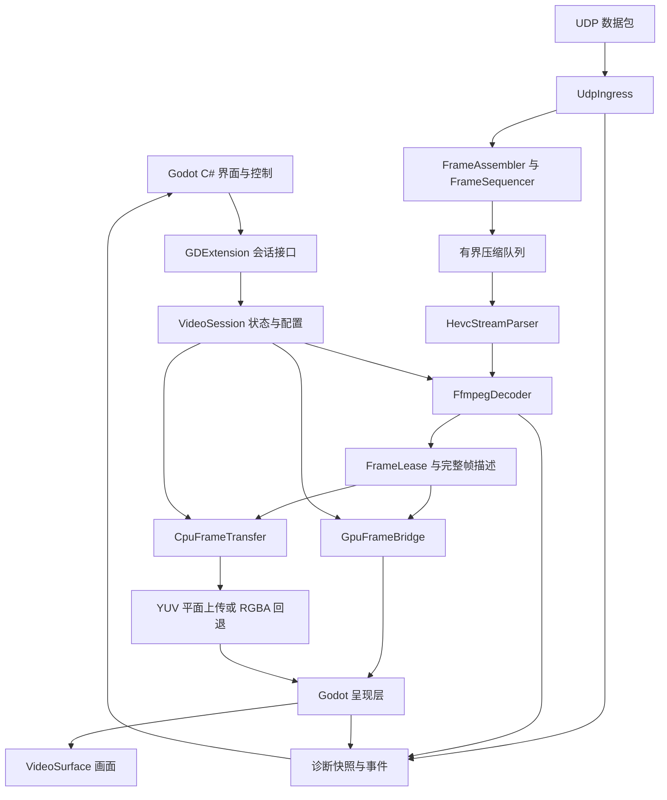
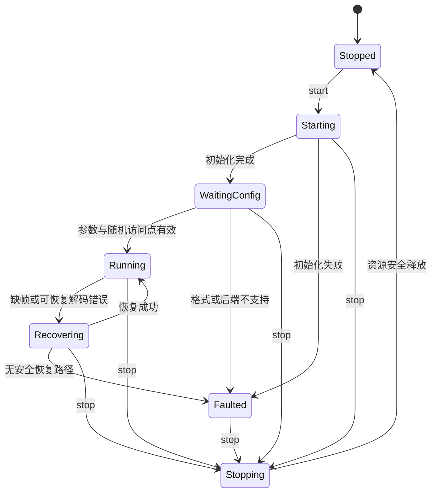

# GPU 帧目标架构与 CPU 兼容路径

状态：设计基线 v1，2026-11-15；M0–M6现已逐阶段通过独立审查，实际实现和支持范围见[D3发布报告](m6-release.md)。本文保留早期设计目标、候选路径及环境基线，后文待验证项不能视为已经交付。

## 1. 目标与边界

用户确认的目标是：**以 GPU 帧传递为目标架构，以 CPU 中转为可交付的兼容路径。** Windows 与 Ubuntu 均需支持，设备范围包含 Intel 核显、NVIDIA 显卡、AMD 核显及其他主流设备。支持等级按具体 GPU、驱动、码流格式和渲染后端验收，不能仅凭厂商名称认定可用。

首版处理一路 RoboMaster UDP HEVC 视频：UDP 3334、1920×1080、60 fps、8 字节大端协议头、最大 1400 字节应用数据、无重传。提供开始/停止、画面、后端状态、性能与断流诊断。音频、MQTT、机器人控制、录屏、多路和视频进程隔离不属于本次首版范围。

支持分成三个独立维度：

- **解码**：硬件解码 / 软件解码。
- **像素传输**：GPU 共享或 GPU 内复制 / CPU YUV 中转 / CPU RGBA 中转。
- **验收状态**：计划中 / 已验证 / 当前组合不支持。

“硬解 + CPU 中转”仍然是硬解；“能够播放”也不自动表示已经达到 1080p60。CPU 型号不直接决定硬解能力，应识别实际 GPU、驱动与所用适配器。

## 2. 本轮选型

| 决策 | 采用方式 | 原因与边界 |
| --- | --- | --- |
| 引擎与界面 | Godot 4.7.2 Mono，C#/.NET 8 管理 UI、设置和会话控制 | 沿用已验证的环境；像素不经过 C# 大数组接口 |
| 视频核心 | C++17 原生库 + FFmpeg | 统一管理 AVFrame、缓冲、硬件设备和资源引用；复用成熟 HEVC 解码能力 |
| Godot 集成 | 小型 GDExtension，内部区分无引擎依赖的核心与 Godot 适配层 | CPU/GPU 两条路径共享同一核心，避免先绑定 CPU 数组再重写 GPU 桥接 |
| 媒体框架 | 首个实现只采用 FFmpeg 的 libavcodec/libavutil/libswscale | 本协议由应用接收重组，暂不需要完整多媒体管线；GStreamer 保留为后续替代选项，不同时维护两套 |
| 默认渲染 | Godot Mobile + Vulkan，先使用 CPU 呈现 | M0 验证 Windows 两张 GPU 加载成功；跨 API Vulkan 资源和同步仍未验证，不能仅据句柄认定可用 |
| 首条 GPU 与渲染兼容 | Windows NVIDIA CUDA → Godot Compatibility/OpenGL；其他组合保留 CPU 帧呈现 | M0 已实际验证 CUDA/GL 设备匹配、GPU 写入/复制、显示与 fence 退役；真实 HEVC 闭环留待 M4。切换渲染器需重启 |
| 发布范围 | 首批 Windows x64 与本机 WSL2 Ubuntu 24.04 LTS x64，Linux 工程位于 `/home/lqx/code/rm_udp_streamer` | 按用户指定使用 WSL 验证；GPU 报告记录 WSLg/驱动条件，原生 Ubuntu 桌面和其他版本作为后续扩展矩阵 |
| 依赖构建 | CMake，Windows 已验证 MinGW GCC 15.2，Ubuntu GCC 13.3；固定 godot-cpp 和 FFmpeg 静态归档 | 具体提交、ABI、工具链和校验值见 build/dependencies.lock.json；保留 GDExtension DLL/SO 边界 |

首轮不修改 Godot 引擎。若公开接口无法提供必要的资源导入或完成同步，相关 GPU 组合应报告不支持并走兼容路径；引擎修改另作决策。

## 3. 总体数据流



压缩码流由 CPU 接收和调度。GPU 路径优化的是解码后的像素传递，允许 GPU 内部复制与转色。

## 4. 模块与职责

| 模块 | 责任 | 不承担的工作 |
| --- | --- | --- |
| `UdpIngress` | 平台 Socket、接收时间、来源隔离、数据报长度检查 | 解码、纹理操作、逐包磁盘日志 |
| `FrameAssembler` | 大端头解析、分片校验/去重、重组、超时与缓存额度 | HEVC 图像解码 |
| `FrameSequencer` | 小窗口内恢复传输顺序、16 位回绕、迟到包过滤、缺口事件 | 推定发送帧号就是显示时间戳 |
| `HevcStreamParser` | Annex-B 解析、跨块处理、参数集/流信息、访问单元边界 | 强制要求真实设备必须发送 AUD |
| `FfmpegDecoder` | 硬件/软件后端、按序喂包与排空输出、FFmpeg 引用和错误转换 | Godot 场景对象访问 |
| `BackendSelector` | 解码设备、渲染设备、格式能力与已验证路径选择 | 仅凭 GPU 厂商启用互通 |
| `FrameRouter` | 根据策略和能力把帧交给 GPU 或 CPU 呈现路径 | 隐藏回退原因 |
| `GpuFrameBridge` | 导入/共享/复制 GPU 帧、必要转色、跨 API 同步 | 擅自将任意原生指针作为 Godot RID |
| `CpuFrameTransfer` | 硬件帧回读、CPU 平面布局处理、必要 RGBA 转换 | 在主线程等待硬件解码 |
| `GodotPresenter` | 渲染线程调度、纹理/材质管理、最新画面提交和安全回收 | Socket 接收和 HEVC 解码 |
| `VideoSession` | 启停、恢复、配置、会话与资源代际、路径切换 | 把可捕获错误与原生崩溃混为一谈 |
| `VideoDiagnostics` | 计数、耗时分位数、实际路径和信号新鲜度 | 把提交纹理当成已扫描到屏幕 |

模块之间用小型接口和拥有明确生命周期的对象通信。核心不依赖 Godot Node、RID 或场景树；Godot 资源只存在于呈现适配层。

## 5. 公共帧契约

### 5.1 压缩数据与时间

`EncodedUnit` 包含 `stream_generation`、本地扩展序号、可选原始 `frame_id`、首次/末次收包单调时间、有效码流长度及带 FFmpeg 所需零填充的缓冲租约。

官方头没有 PTS/DTS 或采集时间戳。网络帧号不是媒体时间戳；本地到达时间也不能标成采集时间。解析器若将多个传输组聚合或拆开，保留输入来源范围，不能伪造一组输入对应一张解码图像。

默认保持 FFmpeg parser 状态，支持零/多输出。只有在样本已证明一个传输组就是完整访问单元时，才启用相应完整包优化；不能根据本仓库发送器带 AUD 就要求真实设备同样带 AUD。

### 5.2 `DecodedFrame` 与 `FrameLease`

`DecodedFrame` 是元数据与负载类型的描述；`FrameLease` 是对像素/硬件表面的强引用和释放责任。可以移动租约，不能把裸指针跨线程传递后立即释放 AVFrame。

| 字段组 | 必需信息 |
| --- | --- |
| 身份 | `stream_generation`、`resource_generation`、本地 `output_sequence`；关联传输组可缺省 |
| 图像 | 编码尺寸、可见裁剪区域、显示比例、像素格式、位深、平面数 |
| 颜色 | range、matrix、primaries、transfer、chroma location；未知值必须标记，采用可配置且有记录的默认解释 |
| 时间 | 可用媒体时间及其来源、接收关联、解码就绪时间；未知保持未知 |
| 设备 | 硬解后端、稳定设备身份（LUID/UUID/PCI 等）、是否硬解 |
| 负载 | `CpuPlanes` 或 `GpuSurface`，两者互斥 |
| 责任 | 所有者引用、生产者完成条件、释放入口和资源代际 |

`CpuPlanes` 保存原生内存引用、每平面地址、有效长度、带符号 stride 和布局。主要支持 NV12、YUV420P；P010/10 bit 根据实际渲染能力处理，格式不支持时显式转换或拒绝，禁止按 8 bit 解释。RGBA8 是通用最后回退，转色需匹配色域与范围。首版以 SDR 显示为验收范围，精度降低需由配置允许并报告；HDR 输入必须有明确转换策略，否则报告未支持，不能直接当作 SDR 显示。

`GpuSurface` 保存后端种类、硬件帧引用、设备身份和后端私有描述。D3D11、CUDA、VAAPI、Vulkan 各自的句柄和同步信息由相应 bridge 解释，不暴露给 C#。GPU 负载转换为可呈现的 `PreparedFrame` 后，由呈现层保管直到安全退役。

`stream_generation` 在重启或切源时改变；`resource_generation` 在解码器重建、设备或图像格式变化时改变。旧代际输出一律不能进入新会话的显示队列。

### 5.3 能力与结果类型

`IDecoder` 负责配置、提交压缩数据、取出全部就绪图像和重置；硬件与软件实现输出相同帧契约。

`IFrameTransfer` 提供 `probe(stream_info, decode_device, render_device)`、`prepare(FrameLease)` 和 `retire(completion)`；结果至少区分 `Ready`、`WouldBlock`、`Unsupported`、`RecoverableError`、`DeviceLost`。

`IPresenter` 接受已准备的帧；仅在渲染线程处理低层图形操作。排队成功、GPU 处理完成和屏幕实际显示是不同事件，不能用一个布尔值混淆。

这些是内部 C++ 契约，首版不设计跨进程 ABI。将来加入 Worker 时，需另外定义共享内存或 GPU 句柄传输协议。

## 6. 三条运行路径与选择规则

### A. 目标 GPU 路径

`硬件 AVFrame → 平台 bridge → 可采样的 Godot GPU 纹理 → GPU 转色/缩放 → 画面`。

可直接共享，也可在 GPU 内复制或转换到桥接器拥有的纹理。初版优先证明“无解码像素回读”；直接采样解码表面属于后续优化。尺寸、图形设备或格式改变时重新协商。

### B. 兼容 CPU YUV 路径

`硬件 AVFrame → 回读原生 YUV 缓冲 → Y/UV 或 Y/U/V 纹理上传 → shader 转色`。

CPU 缓冲由原生核心管理，不经托管 `byte[]` 转交。NV12 使用全尺寸 Y 和半宽半高双通道 UV；YUV420P 使用独立三个平面。处理 stride、裁剪与色度位置；每次更新复用纹理，视频纹理不开 mipmaps。

### C. 通用 RGBA / 软件路径

GPU 平面上传或颜色格式不受支持时，转为 RGBA8 并复用纹理上传。硬解不可用时，按配置切换软件解码，再走同样的 CPU 呈现接口。软件路径必须实际达到目标才能列为性能合格。

### 策略配置

| 配置 | 值 | 行为 |
| --- | --- | --- |
| `decode_policy` | `auto` / `hardware_required` / `software` | 约束解码方式，与是否允许回读独立 |
| `transfer_policy` | `auto` / `gpu_required` / `cpu` | `gpu_required` 不满足时明确失败；`auto` 可回退 |
| `device_preference` | `auto` / 稳定设备标识 | 优先匹配 Godot 渲染 GPU；不长期保存易变的设备枚举序号 |
| `cpu_output` | `auto` / `yuv` / `rgba` | 在可用格式内选择；所有转换和位深降低须可观测 |

自动模式候选顺序为：已验证同设备 GPU bridge → 同一硬解器 CPU YUV → 其他可用硬解器 CPU YUV → 软件解码 CPU YUV。某一步的平面呈现不支持时可用 RGBA；不能为了强求 YUV 而跳过仍可用的硬解。

先探测设备和渲染后端，收到码流参数后再验证 profile/位深/格式；最终 GPU 路径至少要成功准备实际帧才可报告激活。桥接失败不必立即更换解码器；原硬解器仍健康时优先改用 CPU 传输。

本次会话失败的组合进入失败缓存，记录原因，防止每帧重复探测或在两条路径间抖动。重新启用通过显式重试、设置变更或下一次会话进行。

## 7. 平台后端与渲染适配

| 环境 | 首批硬解候选 | GPU bridge 候选 | 兼容基线 |
| --- | --- | --- | --- |
| Windows + Intel/AMD | D3D11VA | 可共享 D3D11 资源与 Vulkan 导入；必要时 GPU 转换到可共享格式 | D3D11VA 回读 + CPU YUV |
| Windows + NVIDIA | D3D11VA、NVDEC/CUDA，按实测排序 | CUDA/Vulkan 互通或 D3D11 共享资源路径 | 任一验证通过的硬解 + CPU YUV |
| 本机 WSL2 Ubuntu + NVIDIA 可见设备 | 先验证 FFmpeg CUDA/NVDEC 实际 HEVC 解码 | CUDA 与 WSLg 实际 Godot 渲染设备互通，能力另测 | 可用硬解回读 + CPU YUV；必要时软件路径 |
| Ubuntu + Intel/AMD | VAAPI；QSV 留作附加适配 | VA 表面导出 DMA-BUF，再按实际格式/modifier 导入 Vulkan | VAAPI 回读 + CPU YUV |
| Ubuntu + NVIDIA | NVDEC/CUDA | CUDA/Vulkan 互通 | NVDEC 回读 + CPU YUV |
| 无可用硬解设备 | 软件 HEVC | 不适用 | 软件 YUV/RGBA，单独评估速率 |

上述 GPU bridge 均为候选，尚未确认全部可以通过 Godot 公共 API 完成。Intel/AMD 独显沿相应平台后端评估，但必须有独立型号验证记录，不能由核显结果推定。

本次确认本机 WSL 发行版为 `Ubuntu-24.04`（Ubuntu 24.04.5、WSL2），以用户 `lqx` 运行，存在 WSLg 显示变量和 `/dev/dxg`，NVIDIA 工具可见 RTX 5070 Laptop GPU。当前没有 `/dev/dri`，不能把原生 Linux 的 VAAPI/DMA-BUF 路径视为本机已可验证；FFmpeg 列出硬件后端也不等于实际 HEVC 解码成功。CMake/G++ 已可用，Linux Godot Mono、.NET 和 Vulkan 能力工具仍需在 M0 准备或定位。

首批不同时实现 Vulkan、D3D12、OpenGL 的所有 GPU 互通。Vulkan 为目标路径，Compatibility/OpenGL 为 CPU 呈现路径；D3D12 渲染初期也只承诺在验证后的 CPU 路径工作。Vulkan Video 解码不是首版依赖。

显卡矩阵必须同时记录渲染设备与解码设备。核显解码、独显渲染时先采用可验证的 CPU 中转，不隐含跨适配器资源共享保证。

## 8. 线程、队列与资源预算

| 执行域 | 工作 | 约束 |
| --- | --- | --- |
| Godot 主线程 | 场景/UI、配置命令、诊断快照、启动呈现调度 | 不等待网络和解码，不逐帧读取 CPU 像素 |
| 接收线程 | Socket、校验、组帧、有限排序、定时清理 | 不做转色/解码；异步异常交控制状态机 |
| 解码线程 | parser、decoder、恢复，CPU 路径回读/转换，发布最新帧 | FFmpeg codec/parser 状态只由本线程维护；持续排空解码输出 |
| Godot 渲染线程 | GPU 导入、上传/转色、提交与资源退役 | 用引擎允许的渲染线程入口；不在这里等待新视频帧 |

初版不增加独立 CPU 转色线程；实测显示需要时再拆分。原生统计可原子更新，UI 低频读取；工作线程不直接修改场景树或发送未调度的场景信号。

初始预算均是可配置工程参数，不是官方协议要求：

- 单个压缩传输组最大 8 MiB；最多 8 个未完成组，组帧总缓冲最大 32 MiB，以先达到的上限为准。
- 压缩队列最多 4 组/16 MiB；组帧与排序建议共享 50 ms 截止预算，从首包到解码输入的最大年龄也受总预算控制，禁止各阶段重复等待 50 ms。
- 保留最多 1 张等待呈现的新图像；替换的是尚未提交的旧图像。GPU 在途显示槽初始上限 3，必须根据真实完成信号回收，不能固定“等三帧”当作完成证明。
- HEVC 参考图像缓冲和 FFmpeg 硬件 surface pool 独立按码流要求分配，不能误限为 1–3 帧。设置解码像素/内存上限，避免仅依靠压缩包长度约束解码后资源。
- 常规输入目标为 1080p；更高分辨率由显式配置允许，并验证上限后再分配。任何预算超限都应计数并执行恢复策略。

GPU 无空闲显示槽时不阻塞收包线程。过期显示候选可以释放；已经提交的资源不能提前归还。压缩队列超限则进入受控恢复，不能使用通用“丢最旧压缩包”后继续假装参考链完整。

## 9. GPU 同步与生命周期硬约束

每个桥接实现必须说明两端同步：**生产者何时写完，Godot 消费者何时读完。**

1. 解码产生帧租约，保存 AVFrame 和硬件上下文强引用。
2. bridge 在渲染域获取可用图像，必要时等待/导入生产者完成信号，再共享、复制或转色。
3. 提交 Godot 使用后，保存帧、导入对象、同步对象和拥有它们的上下文。
4. 若先复制到自有纹理，源帧可在复制完成后释放；目标纹理仍要保留到 Godot 读取完成。若直接采样解码表面，源帧也要等到读取完成。
5. 收到已验证的消费者完成事件后退役资源；格式或会话变化不能绕过这个流程。

资源状态为 `Ready → Acquired → Submitted → Retired`；未提交的 Ready 帧可按租约规则丢弃。GPU 内部命令完成和 CPU 回调返回不是同一件事。

本地 Godot API 核对结果：

- `RenderingServer.call_on_render_thread` 只保证在正确线程执行，不是 GPU fence。
- `RenderingDevice.submit/sync` 仅适用于 local RenderingDevice，不能拿来假定全局屏幕渲染已完成。
- Compatibility/OpenGL 和 headless 下没有全局 RenderingDevice。
- 外部纹理与设备句柄 API 存在，但不保证已启用所有 Vulkan 外部内存/同步扩展。

因此，**外部图像导入、生产者/消费者同步及资源退出必须在 M0/M3 的专门验证中证明**。如果公共 API 不提供安全同步方案，该组合不得发布 GPU 路径。不能每帧用全设备空闲等待掩盖同步问题后称为高性能实现。

CPU 上传路径也要确认引擎何时复制或接管输入；原生内存仅在不再被上传过程读取时归还。释放纹理、GPU 上下文与 fence 的操作归拥有它们的执行域处理。

## 10. 协议与恢复状态机

包长须区分短包、超长包和被 Socket 截断的数据报；解析前检查长度。使用大端无符号字段，同帧总长度一致。固定 1392 模式校验每片预期长度、连续性、完整性及最终总长；变长模式作为显式配置，需实机依据再启用。

帧号按 16 位环绕比较，并限制到当前小窗口；保存有限的已完成/丢弃记录，迟到重复包不能重新开启旧帧。同序号冲突或总长冲突使该组失效，不能在一帧内反复重置计时。默认会话锁定一个已选来源，多个来源不混合组帧；发送端地址不从 MQTT 地址推定。

会话状态：



信号新鲜度与状态分开：未收到数据、最新画面正常、画面过期。建议超过 500 ms 没有新解码图像显示提示，超过 2 s 清除旧画面；持续收到坏包不代表画面正常。

| 事件 | 处理 |
| --- | --- |
| 缺片/顺序缺口/压缩积压超限 | 停止提交受损链路，清理相关 parser/decoder 状态，更新资源代际，等待有效参数集与可恢复随机访问点 |
| bridge 不支持或可捕获导入失败 | 保留健康硬解器，切 CPU 传输，报告模式和原因；必要时先安全退役旧资源 |
| 硬件解码器失效 | 重建或选择下一候选设备；按配置软件回退，等待可恢复码流 |
| 图像尺寸/像素格式变化 | 暂停旧格式提交，重新校验额度和能力，更新资源代际，安全替换纹理 |
| 发送设备重启/切源 | 新 stream generation，清除旧序号基准和跨会话参数集 |
| Godot 渲染设备丢失/原生进程崩溃 | 不承诺会话级恢复；按引擎实际能力报错或重启应用。进程内 C++ 无法保证隔离这类故障 |

保留并更新同会话 VPS/SPS/PPS 时必须保持相互对应；区分 IDR/CRA 等恢复语义，不能把所有 IRAP 简化为同一种强制重启点。无上游控制或重传时，不能承诺固定关键帧等待时间。

停止流程：停止接收新包 → 取消队列并唤醒等待 → 解码线程停止产帧 → 渲染域安全退役在途资源 → 释放 frame/codec/device → 关闭线程与 Socket。停止请求异步；超过安全退出期限进入错误状态，不能强制释放仍被 GPU 使用的内存。未安全退出时禁止无限创建新会话堆积资源。

## 11. Godot/C# 对外接口

计划注册 `RmVideoStream : Node` 和 `RmVideoSurface : Control`。前者拥有会话、在主线程派发事件，后者绑定视频流并显示原生呈现资源。

`RmVideoStream` 提供：`start(config)`、`request_stop()`、`retry_backend()`、`get_status()`、`get_metrics()`、`get_capabilities()`；启动返回请求是否受理，不能据此认定已成功播放。事件包括 `state_changed`、`path_changed`、`format_changed`、`error`。

C# 使用一个类型化包装类集中封装 GDExtension 的动态调用与参数校验；不假定 Godot 会自动生成这些扩展类的 C# 强类型绑定。调用集中在会话控制和低频诊断，视频像素与逐包处理不经过 Variant 接口。

Godot UI 至少显示：当前状态、实际硬解器、解码/渲染设备、当前像素传输路径、回退原因、接收/解码/新画面呈现帧率、最后新帧时间。GPU 模式须由实际成功使用的路径确认。

## 12. 配置、诊断与验收口径

配置分为网络、流预算、解码、呈现和显示五组；保存用户设置和已验证能力报告，运行时传入的配置需版本号及严格范围校验。依赖版本与能力报告不能依靠系统 PATH 随机选择。

诊断记录：包/字节、组帧完整/超时/冲突、重复/迟到/来源不符、parser 输出、解码帧、显示替换、路径切换、CPU 回读次数/字节数、GPU 桥接与在途数量、错误分类、队列年龄、各阶段耗时。

分别报告收包→重组、等待解码、解码、回读、转色、纹理提交。只有输入与输出关联可证明时才报告逐帧合计；屏幕实际呈现延迟另测。1080p60 下单帧周期约 16.67 ms，但不同线程流水线阶段耗时不能简单相加后当作吞吐上限。

建议正常网络下应用处理 P95 ≤ 50 ms 作为初始优化目标，M0/M2 冻结条件后验收。30 分钟运行覆盖一次约 18 分 12 秒的自然帧号回绕；同时直接注入 65535→0 用例。所有性能数字均需实际测量，不能以“启用了硬解”代替验收。

## 13. 计划目录与设计依据

以下目录是实施目标，本次只建立文档：

```text
rm_udp_streamer/
  project.godot
  RmUdpStreamer.csproj
  scenes/
  scripts/ui/
  scripts/interop/              # C# 会话包装，非像素通道
  addons/rm_video/              # gdextension、平台二进制和呈现 shader
  native/
    CMakeLists.txt
    src/core/                  # 配置、帧契约、状态、诊断
    src/transport/             # UDP、分片、排序
    src/media/                 # FFmpeg parser/decoder、CPU 转换
    src/interop/               # 平台 GPU bridge
    src/godot/                 # Node/Control、线程与纹理适配
  third_party/                 # 固定版本清单、构建/发布说明和许可
  docs/
```

非上线必需的测试、故障注入、样本和性能报告按仓库约定放入外层 `processing/<对应任务>/`，不混入发布工程。发布所需的依赖构建/打包脚本属于正式工程。

本地依据：[UDP 协议](../../references/udp_protocol.md)、[发送器说明](../../stream_sender/README.md)、[业界调研](../../processing/2026-11-15-industry-video-research/industry-practice.md)、[Godot API](../../Godot_v4.7.2-stable_mono_win64/GodotSharp/Api/Release/GodotSharp.xml)。外层引用用于本工作区溯源，独立克隆接收器时可能不存在；架构的核心约束已经写入本文。

执行顺序、验证矩阵与交付门槛见 [实施计划](implementation-plan.md)。
