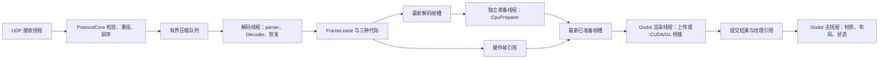

# 当前实现架构（R0–R6 改进分支）

本文描述当前代码职责，当前运行候选为 `1366817`，包含默认参数持久化、Linux Wayland 退出修复和自动传输停止时序修复。历史候选的 R0、R1、R2、R3、R5 已独立审查通过；R4/R6 完整验收仍在进行。当前功能与运行身份见[候选记录](evidence/r6/candidate-1366817.md)，参数来源与更新行为见[默认参数记录](evidence/r4/persisted-parameters.md)。[早期设计](architecture.md)保留研究方向，不作为当前接口或支持声明。

## 分层与所有权

| 代码区域 | 实际职责 |
| --- | --- |
| `native/src/transport` | IPv4 Socket、协议校验、来源过滤、重组/排序和压缩队列；独立于 Godot |
| `native/src/media/device.*` | 后端枚举、序号/稳定身份解析、设备创建、实际身份核对 |
| `native/src/media/decoder.*` | 顺序处理压缩码流、解析参数、HEVC 解码、硬件格式协商、恢复与后端回退 |
| `native/src/media/cpu_preparer.*` | 硬件回读、平面布局、RGBA 转色及有界缓冲池；由独立准备线程拥有 |
| `native/src/media/session.*` | 最新帧选择、准备线程、代际失效、失败状态、计数守恒、停止协调 |
| `native/src/godot` | 会话绑定、渲染线程调度、上传、CUDA/GL 同步、纹理发布和 GPU 退役 |
| `scripts/interop` | 少量配置/诊断字典；不传输托管视频像素数组 |
| `scripts/ui` | 连接和设备控件、设置、节奏、状态与有截止时间的退出/重启 |

CPU 路径仍顺序解码压缩流，只在解码完成后替换未准备的旧帧。准备线程同时最多保留一张正在处理的源帧，最新槽最多一张；不会把压缩 HEVC 帧直接当成可随意跳过的独立图片。输出缓冲最多三份，仅消费者释放后复用。回读或转色不在 UI/渲染线程执行。

`FrameLease` 持有 FFmpeg 帧引用；CUDA、D3D11VA 和 VAAPI 的硬件帧可使设备/帧池活到 Decoder 销毁之后。VAAPI 通过 FFmpeg 的 DRM→VAAPI 派生引用链管理显示和 fd，不改写 FFmpeg 私有结构。

CPU 上传保留最多三组 `PackedByteArray`，存在 Image/渲染器引用时写入会分离存储。逐帧像素复制和 Image 创建仍存在，缓存地址变化次数不等于完整分配次数。

GPU 路径使用私有互操作纹理和 Godot 采样纹理，继续保留 GPU 内复制。CUDA 完成事件、GL 消费者 fence 与退役计数保证在途对象不被提前复用。可捕获退役失败保留隔离对象并禁止继续分配新的桥接资源；不能为了让计数归零强行释放。

## 代际与停止

`stream_generation` 隔离换源/重启和压缩流恢复，`resource_generation` 隔离尺寸或格式变化，`presentation_generation` 隔离 GPU→CPU 回退。准备结果、上传工作和纹理发布均须匹配当前接受的代际，旧结果在明确计数后丢弃。

传输组另外携带 `configuration_generation` 和实际来源地址：同一来源 IP/UDP 端口的空闲恢复保留配置作用域，换来源时更新。解码器只复用已实际解出帧的参数，仍刷新解析器、参考帧和输出代次，并等待新的随机访问帧。自动缓存模式按 IPv4 绑定参数，同 IP 换端口时可保留这个来源已解码的新配置；不同 IP 不能借用该配置。来源随每个组传递，不从可能已经变化的实时 Socket 快照推断。

实时接收会话先建立轻量 HEVC parser/context，等带内或匹配的启动参数链与随机访问帧完整后才打开硬件后端。首幅可解码图像持有匹配的参数，硬件初始化后的队列丢弃仍走正常恢复路径。此调整防止初始化 GPU 时将唯一参数组按 50 ms 队列年龄丢弃；没有放宽压缩队列预算。直接构造 Decoder 的离线调用默认仍立即打开后端。空流或缺参数的实时会话不会据设备枚举宣称已启用硬件解码。

`HevcParameterCache` 在 UI 层读取和原子保存 `user://hevc-parameters.json`；核心不访问磁盘。首次回退为已核验的 192.168.12.1 参数。解码器在新配置成功解码后发布带来源的参数版本，主线程只在版本变化时读取，内容不变不重复写盘。新带内参数优先于启动提示，失败更新不会替换已验证值。`--parameter-cache off` 禁用自动加载和保存；`--hevc-parameters` 仍为要求 `--source-ip` 的显式覆盖，只允许1–262144字节、完整引用链且不含图像的 Annex-B 参数。快照区分启动候选已提供、来源匹配及已解码配置的版本；详细行为见[使用说明](usage.md)。

解码线程完成、渲染资源退役、退役失败分别报告。UI 请求停止后轮询终态，定时退出和渲染器重启使用 5 秒实时时限。截图等待绘制最多 2 秒；窗口不绘制不能无限阻止停止。真正不返回的驱动调用仍是进程级故障边界。

## 预算与观测

默认单组压缩数据最多 8 MiB；重组最多 8 组/32 MiB，压缩队列最多 4 组/16 MiB。组帧与排队共享从首包开始的 50 ms 年龄预算。GPU 桥接最多三个在途槽；FFmpeg 自己的参考图像/解码表面池另行管理。

诊断采用有界直方图、完整秒窗口和分类丢弃计数。首包到提交的组合延迟只统计能证明关联的帧；未知关联保持未知。已解码、准备完成、纹理提交、主线程接受分别计数，均不声称等于物理屏幕扫描。

Windows 硬件渲染的自动节奏可使用 120 次/秒处理上限，Vulkan 使用 Mailbox，OpenGL 关闭显示同步。Linux 自动模式保留启动策略；显式低延迟模式可选。非默认引擎策略保留，正常停止恢复原值及本进程定时器请求。

## 可迁移性与当前边界

产品构建锁定 Godot、godot-cpp、FFmpeg、SDK 和工具版本，并检查完整 FFmpeg 头文件、静态库及配置输入。重新构建依赖需要独立 developer 锁，不能继承旧产物的验证结论。静态 FFmpeg 的源码、许可和可重链接对象随发布包提供；VAAPI 另依赖系统 libva/libdrm 和 GPU 驱动。

原生 Ubuntu Intel/AMD 的核心硬解、回读、身份、帧引用寿命、桌面功能和回退已有实机证据。当前 `1366817` 的两台 Ubuntu 独立包通过指定 VAAPI/YUV/Wayland/Mobile 组合的正式长测及诊断对照；Windows CUDA 与 Intel D3D11VA 的正式平均帧率未达门槛，详见[性能记录](evidence/r6/candidate-1366817-performance.md)。完整集成审查尚未完成。Windows CUDA/OpenGL 为已实现 GPU 桥接；D3D11/Vulkan、VAAPI/DMA-BUF/Vulkan 直传仍不能列为已实现。WSL 不能替代原生 Ubuntu，模拟发送样本不能替代真实 RoboMaster 设备。
