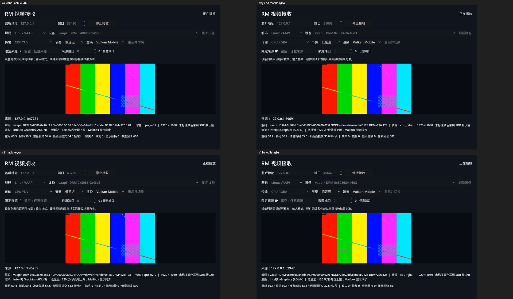

# Intel接屏补验与R4当前边界

2026-11-16。Intel N250的物理屏幕、实际硬解呈现和生命周期已补验；当前发行包在该机尚未达到1080p60门槛。真实UDP在提前监听后重新开流，已捕获初始化参数并验证实际硬解画面，先前失败仍保留，见[真实流记录](real-stream.md)。**R4与R6仍未完成，也未发起阶段完成审查。**

## 被测身份和桌面

运行源码为`88bf17a9e046db6d75d3301e09d893fb1e8f4ed5`。Ubuntu 24.04.5、内核7.0.0-43、Intel N250 / ADL-N `8086:46d3`、i915，实际解码设备为`vaapi:pci:0000:00:02.0`。HDMI-A-1已连接UGR/UGREEN显示器，1920×1080、60Hz、scale 1；Wayland桌面上的X11运行使用Xwayland，不代表原生Xorg会话。

| 被测文件 | SHA256 |
| --- | --- |
| 文档刷新包manifest | `ab1a457bb15fb6da977cb14a92e21b5816bc77e0565f432a23f4a8144bec0205` |
| 发行原生SO | `32af73a97a4dc73c7d9388524406a253a36e81bb52218ec880bd1a2575e56cc5` |
| 托管程序集 | `1214eb533c807498b78f93a14359e31790a1644ccfbeca38d9542ab9dd1a3d52` |

## 功能和生命周期

[14项矩阵复核](intel-matrix-review.json)覆盖Wayland/Xwayland × Mobile/OpenGL × YUV/RGBA的8项播放、auto传输、错误身份软件回退、显式软件，以及3项非法组合拒绝。原监督脚本将实际`cpu_nv12`/`cpu_yuv420p`误写为`cpu_yuv`，因此原状态仍为FAIL；逐项按冻结实现核对原始输出后，功能通过，性能未通过。没有改写原结果。

[故障、恢复及生命周期摘要](intel-functional-summary.json)记录发行包故障/恢复通过，以及精确发行SO的60轮生命周期：每轮1080p与720p各至少30次新提交及主线程接受，最大停止17ms，退役、重复停止和端口重绑通过。四分窗RSS中位399.43/400.36/400.25/401.19MB，线程31/30/30/30，fd均76。生命周期使用编辑器专用场景，不是发行界面按钮60轮；早期SDK入口失败和0/3电源属性观察均保留。

原矩阵截图拍摄于停止发送后的清图状态，故另补[4项收流中截图](intel-live-pictures.json)。输入1920×1080，视口图片1544×1011；Wayland报告60Hz，Xwayland报告59.96Hz。后者仅通过功能检查，未降低正式性能刷新率门槛。原等待缓冲stdout造成的迟发失败、截图监督脚本不适用的60Hz断言失败均保留。

## 性能诊断

正常解锁并禁止空闲后仍曾进入显示省电，后使用短暂的Mutter远程输入会话作相对指针移动并立即停止会话，配合原空闲抑制。预检及后续完整对照全程电源属性为0、桌面未锁。结束后恢复原显示、锁屏及balanced电源策略；这不等于测量了物理扫描。

[电源策略对照](intel-profile-comparison.json)事前固定balanced/performance/performance/balanced，各10秒预热加60秒有效输入，使用同一发行包与冻结统计：

| 轮次 | 均值 / P10 fps | 首片→提交P95 / P99 |
| --- | ---: | ---: |
| balanced 1 | 55.8667 / 55 | 60 / 69ms |
| performance 1 | 57.5667 / 56 | 51 / 60ms |
| performance 2 | 57.05 / 56 | 54 / 62ms |
| balanced 2 | 55.85 / 55 | 60 / 68ms |

四轮均未达到既定门槛，未启动已知不满足的180/1800正式长测。运行CPU频率各核中位约3.2GHz，不能用空闲时的800MHz解释结果。原策略对照因权限拒绝中断的组及只准备未运行的v2均保留。

[详细诊断开关对照](intel-diagnostics-comparison.json)同样为完整10/60 off/on/on/off：55.7833/55.9333/55.9667/55.75fps，没有显示关闭诊断可解除当前掉帧。它不是规定的30/300正式成本验收。

[UI工程探针](intel-ui-comparison.json)从固定提交制作两份临时项目，发行SO相同，两份都有相同计时插桩，唯一行为差异是周期UI刷新由0.25秒改为2秒。完整baseline/slow-ui/slow-ui/baseline各10/60结果为55.8167/59.4833/59.45/55.8167fps，准备后等待P95从36ms降至7.8/7.9ms。此结果支持UI更新相关工作造成主线程停顿；Refresh自身中位仅约0.47–0.59ms，不能把延迟布局、文字与绘制代价算入该函数计时。临时项目不是发行候选，也未将正式UI刷新改为2秒。后续需先验证一次构造文字、仅变化时赋值及按指标采样周期更新的具体方案，再决定产品修复和受影响组合回归。

## 归档与后续

[证据索引](evidence-index.json)列出发布副本、摘要和原始路径。[矩阵归档](intel-matrix-archive.json)共9,483,388字节，SHA256 `2ec377371069ab47448f5265e16c422e1bb32e5bf0248f5fa32a9f10f9c31afa`。[后续完整归档](intel-followup-archive.json)共29,624,892字节，SHA256 `39d10a8aec02cfdee80390474baa1a63b618166270502e29f09d0e1304a21d09`；[本地核验](intel-followup-verification.json)逐字节检查全部960个负载成员通过。完整归档含原始失败、原始测量、临时源码/二进制和缓存，位于外层`processing/2026-11-16-rm-intel-display`。277成员的审查提取子集不替代完整原件。

用户要求优先验证的真实流解码已通过；Intel具体UI优化的后续工程对照单独保留，尚未用于发行候选。原生Ubuntu NVIDIA、Windows AMD以及真实设备完整验收仍未齐备；本次仅更新证据文档，候选ZIP与运行代码未变。
